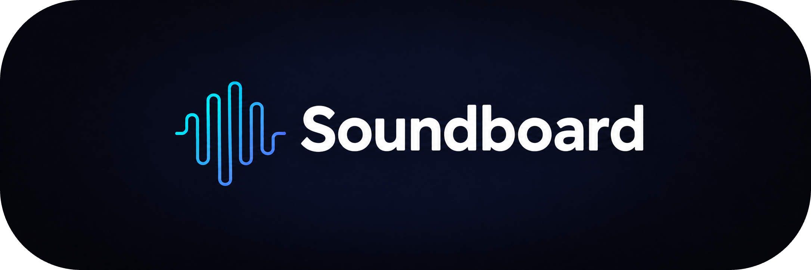
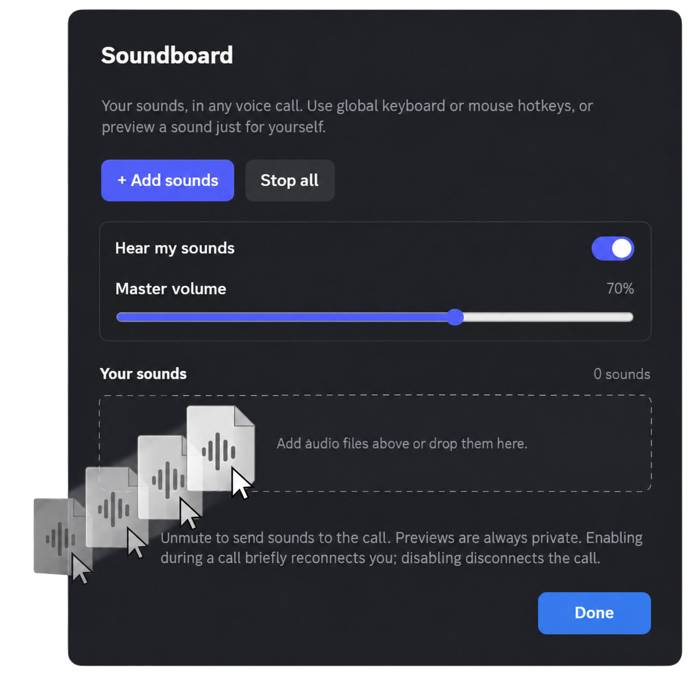

  

Play your own sounds in Discord voice calls with BetterDiscord.

[Download](https://github.com/8ug8ird/Soundboard/releases/latest) · [Report an issue](https://github.com/8ug8ird/Soundboard/issues) · [Contribute](https://github.com/8ug8ird/Soundboard/pulls) · [Discussions](https://github.com/8ug8ird/Soundboard/discussions)

 

> [!WARNING]
> **Future Discord client compatibility**
>
> Discord has announced plans to replace its Electron desktop client with a native Rust client. Soundboard depends on BetterDiscord and the current client’s internals, so it will not automatically be compatible with the replacement.
>
> Future support will depend on whether BetterDiscord or another suitable integration becomes available. A rewrite of Soundboard alone would not resolve this dependency.
>
> Soundboard has not been discontinued. Development continues for the current client, and this notice does not indicate a current compatibility issue.

 

## Features

- **Custom sounds:** Import your own audio and play it for everyone in a voice call.
- **Global hotkeys:** Trigger sounds from any app.
- **Clip editing:** Select exactly which part of a sound to play without modifying the original file.
- **Volume & previews:** Adjust volume and listen privately.
- **Sound library:** Find sounds quickly, save favorites, and customize them with emojis.

 

  

## Installation

Requires [BetterDiscord](https://betterdiscord.app).

1. Download `Soundboard.plugin.js` from the [latest release](https://github.com/8ug8ird/Soundboard/releases/latest).
2. In Discord, open **Settings → Plugins → Open Plugins Folder**.
3. Move the file into that folder and enable **Soundboard**.

## How to use

1. Open Discord's Soundboard panel and select **Your sounds → Manage sounds**, or open the plugin's settings from **Settings → Plugins**.
2. Select **Add sounds** to import audio. Optionally assign hotkeys, change volume, or select **Edit clip** to trim playback.
3. Join a voice call, unmute your microphone, and click a sound, select **Play**, or use its hotkey.

**Anyone in the call who can hear you can hear your sounds. They don't need BetterDiscord or this plugin.**

 

> [!WARNING]
> BetterDiscord modifies the Discord client, which is not permitted under Discord's Terms of Service. Use at your own risk.

 

[GPL-3.0](LICENSE) © [8ug8ird](https://github.com/8ug8ird)
