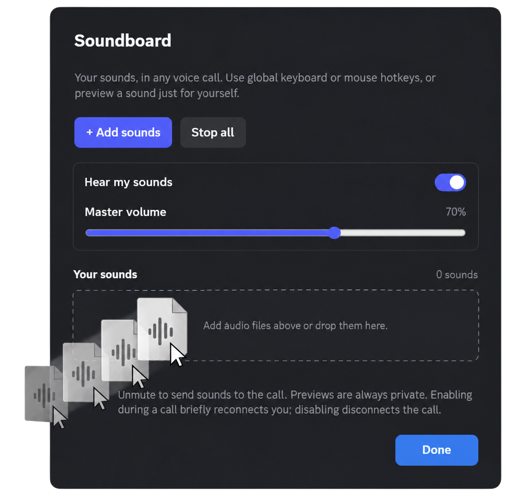

  

A BetterDiscord plugin that lets you play your own sounds for everyone in a Discord voice call to hear.

[Download](https://github.com/8ug8ird/Soundboard/releases/latest) · [Report a bug](https://github.com/8ug8ird/Soundboard/issues) · [Contribute](https://github.com/8ug8ird/Soundboard/pulls)

## Features

  <strong>Custom Sounds, Heard by Everyone</strong> 
  Import your audio files and play them directly into the call. No plugin-imposed limits on sound count or audio duration.

  <strong>Global Hotkeys</strong> 
  Play sounds with keyboard or mouse shortcuts, even when Discord is unfocused.

  <strong>Waveform &amp; Clip Editing</strong> 
  Play the full audio or select a clip using draggable trim handles and precise start/end controls. Restore the full audio without modifying the original file.

  <strong>Volume &amp; Private Previews</strong> 
  Adjust individual and master volumes while sounds are playing. Preview a sound privately before sending it to the call.

  <strong>Your Sound Library</strong> 
  Find sounds with search, mark favorites, choose emojis, and manage hotkeys in one place.

 

## Installation

Requires [BetterDiscord](https://betterdiscord.app).

1. Download `Soundboard.plugin.js` from the [latest release](https://github.com/8ug8ird/Soundboard/releases/latest).
2. In Discord, go to **Settings → Plugins → Open Plugins Folder**.
3. Move `Soundboard.plugin.js` into that folder.
4. Enable **Soundboard** in the Plugins settings.

## Usage

1. Open Discord's Soundboard panel and select **Your sounds → Manage sounds**. You can also open the plugin's settings from **Settings → Plugins**.
2. Select **Add sounds** to import audio files.
3. Optionally choose an emoji, assign a hotkey, adjust the volume, or use **Edit clip** to select part of the audio.
4. Join a voice call and unmute your microphone. Click a sound in the panel, use **Play** in the management window, or press its assigned hotkey to send it to the call.

**Sounds are transmitted through your voice connection. Everyone in the call who can hear you can hear them, including people without BetterDiscord or this plugin.**

### Play, Preview, and Hear my sounds

| Control | What others hear | What you hear |
| --- | --- | --- |
| **Play / sound tile / hotkey** | The sound is sent to the call while your microphone is unmuted. | The same sound if **Hear my sounds** is enabled. |
| **Preview** | Nothing is sent to the call. | A private preview, including when your microphone is muted. |
| **Hear my sounds** | No change to what is sent to the call. | Turns local monitoring of call playback on or off. Private previews still work. |

## Controls & Behavior

- **Playback:** In the management window, **Play** and **Preview** switch to stop controls while their respective audio is playing. **Stop all** stops active plugin sounds and previews.
- **Hotkeys:** Assign keyboard or mouse shortcuts, or use **Remove hotkey** to clear a binding.
- **Volume:** Individual volume changes and the master volume apply to sounds already playing.
- **Clips:** Trim the playback selection without changing the original audio. **Use full audio** restores the full selection.
- **Favorites:** Favorite sounds appear first in their own section. Up to six favorites also appear in Discord's quick hover panel.
- **Library:** Search imported sounds by name or assigned hotkey. Sounds and settings are stored locally.
- **Removal:** Removing a sound offers an eight-second **Undo** option.

 

> [!NOTE]
> - Sending sounds to a call requires an unmuted microphone. Private previews work independently.
> - Enabling Soundboard during a call briefly reconnects voice. Disabling it disconnects the call.
> - Imported sounds are stored locally and are not uploaded to Discord's native soundboard. Other participants hear the playback, but do not receive your sound library.
> - Sound count and duration are not restricted by the plugin, but long files and simultaneous playback still use your computer's resources.

 

## Feedback & Contributing

Report bugs or suggest improvements through [Issues](https://github.com/8ug8ird/Soundboard/issues).

Code contributions can be submitted through [Pull Requests](https://github.com/8ug8ird/Soundboard/pulls).

 

> [!WARNING]
> BetterDiscord modifies the Discord client, which is not permitted under Discord's Terms of Service. Use at your own risk.

 

MIT © [8ug8ird](https://github.com/8ug8ird)
